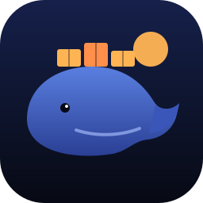
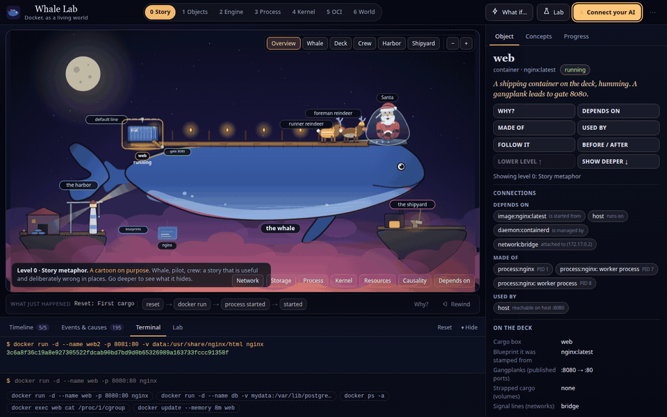
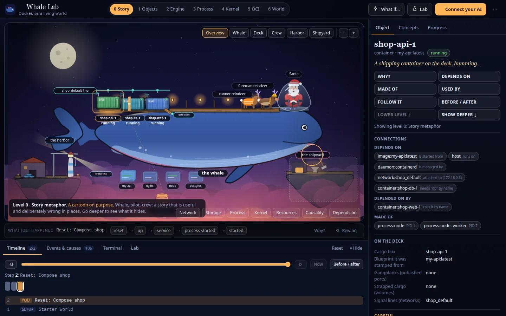
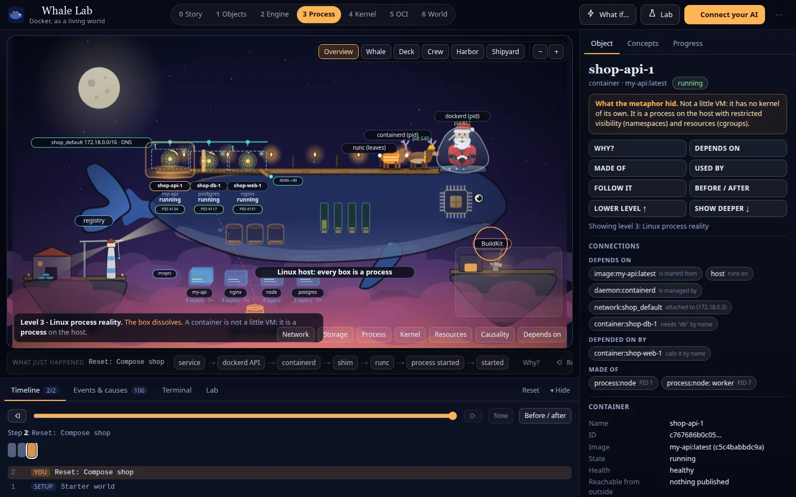
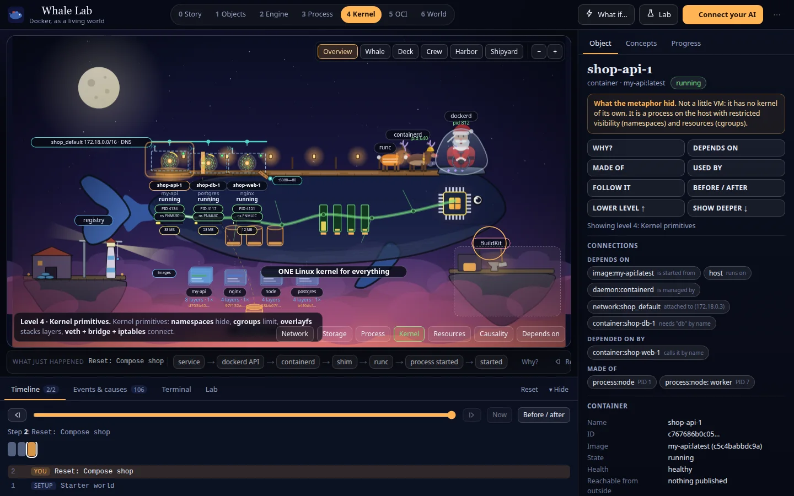
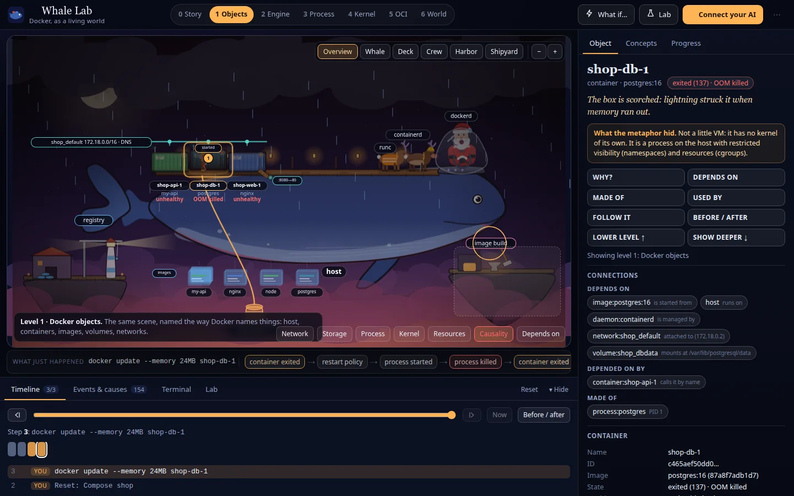
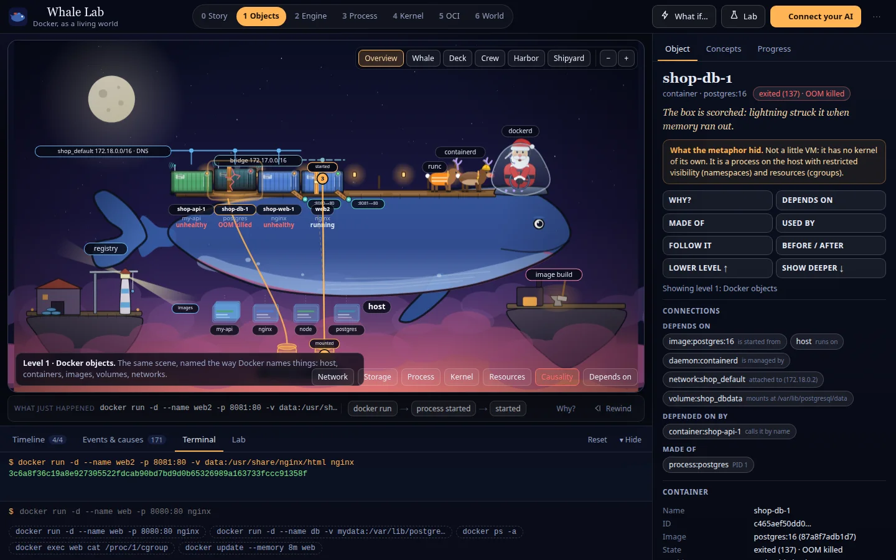
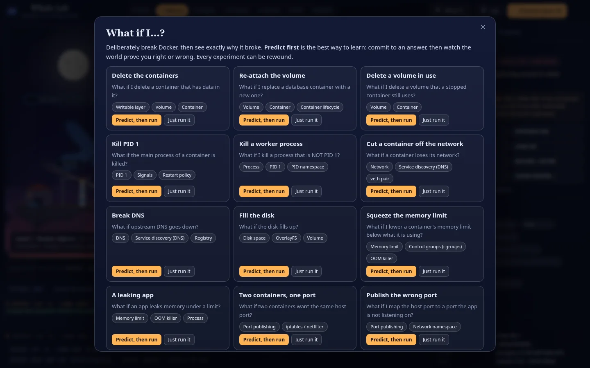
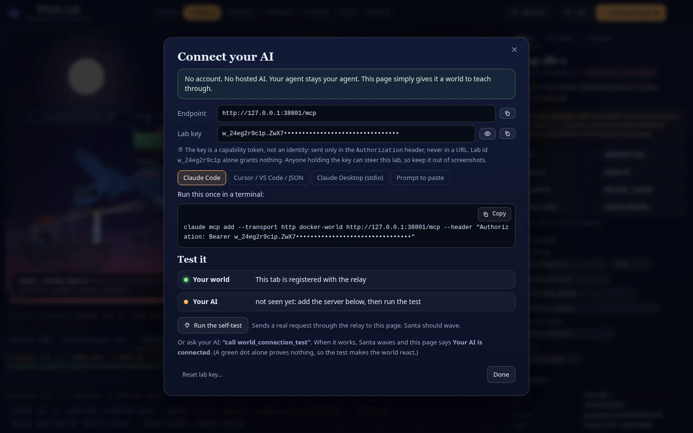
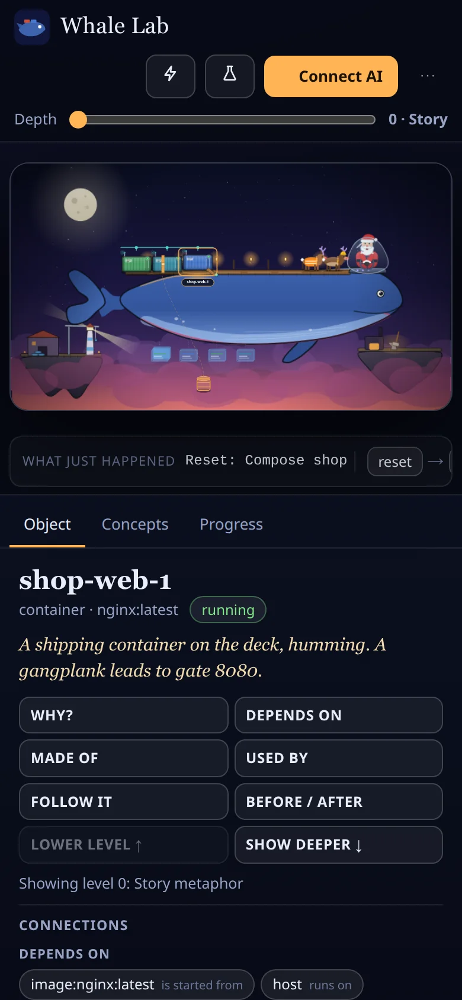

<div align="center">



# Whale Lab

**Docker, as a living world. Your own AI teaches it over MCP.**

[**Live demo →**](https://learndocker.hamdibouzidi.com) &nbsp;·&nbsp; [Architecture](docs/ARCHITECTURE.md) &nbsp;·&nbsp; [Contributing](CONTRIBUTING.md)

[](LICENSE)




</div>

Whale Lab is an interactive Docker learning world. The whale is the host, Santa is `dockerd`, the reindeer crew are `containerd` and `runc`, and the shipping containers are containers. Switch the abstraction level and the same scene sheds the metaphor: at level 3 the shipping box dissolves into what it really is, a **process on the host**. A container is not a little VM.

The twist: **there is no built-in tutor.** You connect your own AI (Claude Code, Cursor, Claude Desktop, any MCP client) and it drives the world while it teaches: breaking things on purpose, tracing causes, rewinding, quizzing you.

- No accounts, no hosted AI, no server-side lab state.
- The browser owns a deterministic Docker simulation. A thin Cloudflare Worker only relays MCP calls to your tab.
- Seven levels of truth: **Story → Objects → Engine → Process → Kernel → OCI → Ecosystem.**

## See it

| | |
|---|---|
|  **Level 0:** a cartoon, on purpose. |  **Level 3:** the box dissolves into a process. |
|  **Level 4:** namespaces and cgroups, not magic. |  **Cause and effect:** a memory limit change and its crash loop. |
|  **A real-looking terminal** that explains each part of the command. |  **27 "what if…" experiments**, predict first, then watch. |

<details><summary>Connect dialog and mobile</summary>

 
</details>

## Try it in 60 seconds

1. Open **https://learndocker.hamdibouzidi.com**
2. Press **Connect your AI**, then **Run the self-test** (Santa waves, proving the pipe works end to end).
3. Add the endpoint to your AI client. For Claude Code:

   ```bash
   claude mcp add --transport http docker-world https://learndocker.hamdibouzidi.com/mcp \
     --header "Authorization: Bearer <labId>.<secret>"
   ```
   The dialog shows your own key, plus configs for Cursor / VS Code, Claude Desktop and a paste-in prompt.
4. Ask: *"Teach me why my container lost its data when I deleted it."*

Your key is generated in your browser and never sent in a URL. See [security](#security-model).

## What it teaches

A container is a process · image vs container · lifecycle · Dockerfile, layers and build cache · volumes and persistence · networks, DNS, isolation · port publishing · `dockerd` / `containerd` / shim / `runc` · PID 1 and signals · namespaces · cgroups and the OOM killer · registries · Compose and health cascades · debugging · OCI standards · the Kubernetes/cloud bridge.

Every one of 27 experiments carries a prediction whose stated answer is **machine-verified against the simulator** in tests, so the lab can't teach something its own world contradicts.

## How it works

```
YOUR AI ──MCP (HTTP, Bearer labId.secret)──▶ Worker /mcp ──▶ Lab Durable Object ──WebSocket──▶ YOUR BROWSER
                                                                                               ├─ world engine (pure reducer, causal events, timeline)
 you click / type / turn dials ──────────────────────────────────────────────────────────────▶ ├─ concept graph (70 concepts), scenarios
                                                                                               └─ projection ─▶ Rive art + SVG relationships
```

- **Semantic mutations only.** The AI says `run_container` or `set_resource_limit`; it can never set pixels or frames. The renderer decides what it looks like.
- **Event-sourced.** Every change records what caused it, so you can rewind, step, branch and diff before/after.
- **Rive does the art**, an SVG layer draws data-driven relationships, and real DOM buttons keep it keyboard and screen-reader accessible.

Details: [docs/ARCHITECTURE.md](docs/ARCHITECTURE.md) · Rive internals: [rive/README.md](rive/README.md)

### The 14 MCP tools

`world_inspect` · `world_focus` · `world_mutate` (34 typed actions) · `world_run_scenario` · `world_set_view` · `world_set_overlay` · `world_compare` · `world_rewind` · `world_reset` · `world_connection_test` · `concept_inspect` · `concept_trace_relationship` · `lesson_check_understanding` · `lesson_get_progress`

Tool descriptions double as the teacher's manual; the server also sends it in the MCP `initialize` instructions.

## Run it locally

```bash
npm install
npm run dev:relay     # Worker + Durable Object on :8787 (set RELAY_PORT if taken)
npm run dev           # Vite on :5173, proxies /mcp and /ws to the relay
```

```bash
npm test              # 113 unit tests
npm run test:relay    # real workerd + official MCP SDK client
npm run test:e2e      # real Chrome, Rive, Worker (builds first)
npm run build         # typecheck + production bundle in dist/
```

Requires Node 22+. Rebuilding the Rive art (`npm run build:rive`) also needs the [`rive` CLI](https://rive.app); the compiled `.riv` is committed so you don't need it to run the app.

## Deploy your own

One Worker serves the site, `/mcp` and `/ws`, with one SQLite-backed Durable Object per lab.

```bash
npm run build && npx wrangler login && npx wrangler deploy
```
Add your domain under `routes` in `wrangler.jsonc`. Cloudflare Workers Builds also works from this repo with build command `npm run build` and deploy command `npx wrangler deploy`.

## Security model

- The lab id is public routing; the **secret** is a 256-bit capability token sent only in the `Authorization` header (and in the browser socket's first message), never in a URL.
- The relay stores `sha256(secret)` only. The first browser to present a pair claims the lab.
- Strict CSP (`wasm-unsafe-eval` only for the Rive runtime), `nosniff`, no-referrer. axe-core WCAG 2 A/AA is clean on five views.

Report vulnerabilities per [SECURITY.md](SECURITY.md).

## Status and limitations

First public version. Be aware:

- It is a faithful **simulation**, not a Docker daemon. One sample Dockerfile, one Compose project, a fixed image catalogue. A live-Docker adapter is a natural fit (everything flows through one typed reducer) but is not built.
- Six deck slots; extra containers collapse into an overflow chip.
- The relay has no rate limiting yet.
- Rive performance was measured in headless software GL only; not yet on real phones or GPUs.

See the [roadmap](ROADMAP.md) for what's next.

## Contributing

Issues and PRs are welcome. Start with [CONTRIBUTING.md](CONTRIBUTING.md); please follow the [Code of Conduct](CODE_OF_CONDUCT.md).

## License

[MIT](LICENSE) © Hamdi ZYG-ZXG
